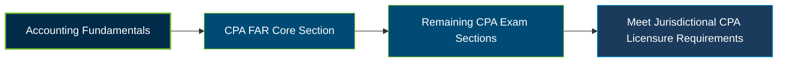

# AICPA CPA Financial Accounting and Reporting (FAR) Exam Guide

A dedicated, comprehensive study guide and accounting reference repository for candidates preparing for the **AICPA Uniform CPA Examination – Financial Accounting and Reporting (FAR) section**.

---

## Exam Overview

The Financial Accounting and Reporting (FAR) section of the Uniform CPA Examination evaluates the accounting knowledge and skills required to prepare, analyze, and understand financial information for business entities, not-for-profit organizations, and other reporting environments.

- **Exam Format**: Computer-based examination consisting of multiple-choice questions (MCQs) and task-based simulations (TBSs).
- **Target Audience**: CPA candidates, accounting graduates, financial accountants, auditors, and accounting professionals.
- **Prerequisites**: Eligibility requirements vary by jurisdiction. Candidates should verify education and application requirements with their applicable Board of Accountancy.

---

## Core Exam Domains & Knowledge Areas

### 1. Financial Reporting

- Financial reporting frameworks, accounting concepts, and standard-setting principles.
- Financial statements and reporting requirements for business and not-for-profit entities.
- Financial statement presentation, disclosures, and reporting analysis.

### 2. Select Balance Sheet Accounts

- Accounting for cash, receivables, inventory, and other current assets.
- Property, plant and equipment, intangible assets, investments, and related valuation.
- Liabilities, debt, equity, and other selected balance sheet accounts.

### 3. Select Transactions

- Accounting for revenue, leases, business combinations, and related transactions.
- Investments, derivatives, foreign currency transactions, and other specialized accounting topics.
- Recognition, measurement, presentation, and disclosure of selected transactions.

---

## Certification Path

The following diagram represents a suggested study and examination progression. FAR is one of the three required Core sections; candidates must also pass the other Core sections and one Discipline section to complete the CPA Exam.

---

## Recommended Practice & Study Resources

To prepare effectively for the CPA FAR section, combine the official examination blueprint with accounting standards study and practical question-based review.

- **CertsGate**: Explore [CPA Financial Accounting and Reporting (FAR) preparation resources](https://certsgate.com/exams/aicpa/cpa-financial) for supplementary study materials and practice questions.
- **Accounting Standards & Practical Study**: Study the [FASB Accounting Standards Codification](https://asc.fasb.org/), relevant [GASB standards](https://www.gasb.org/), and financial statements to strengthen your understanding of accounting recognition, measurement, presentation, and disclosure.
